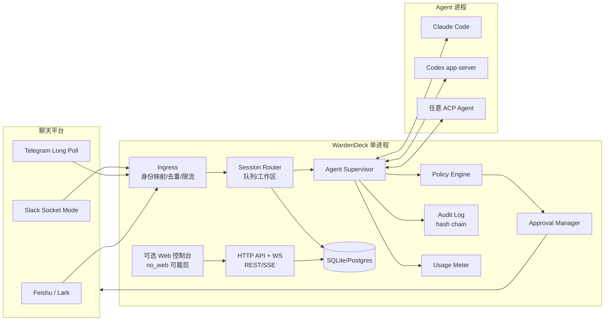
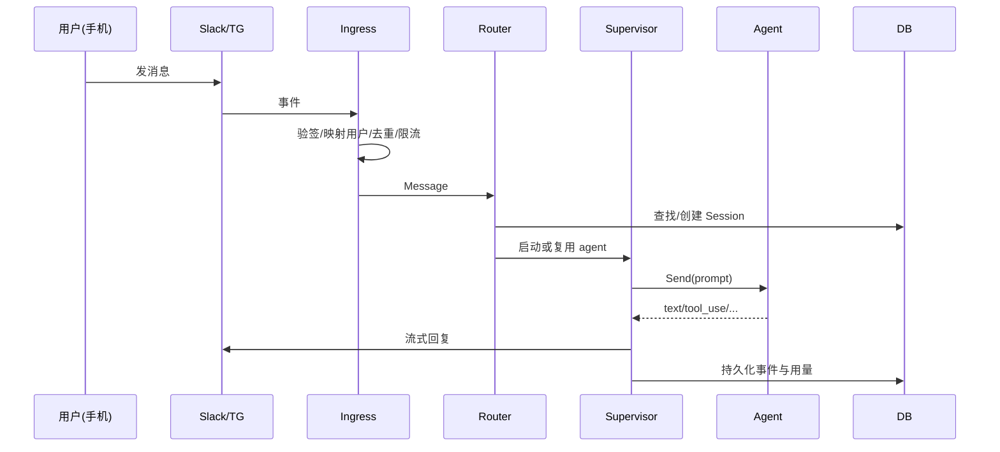
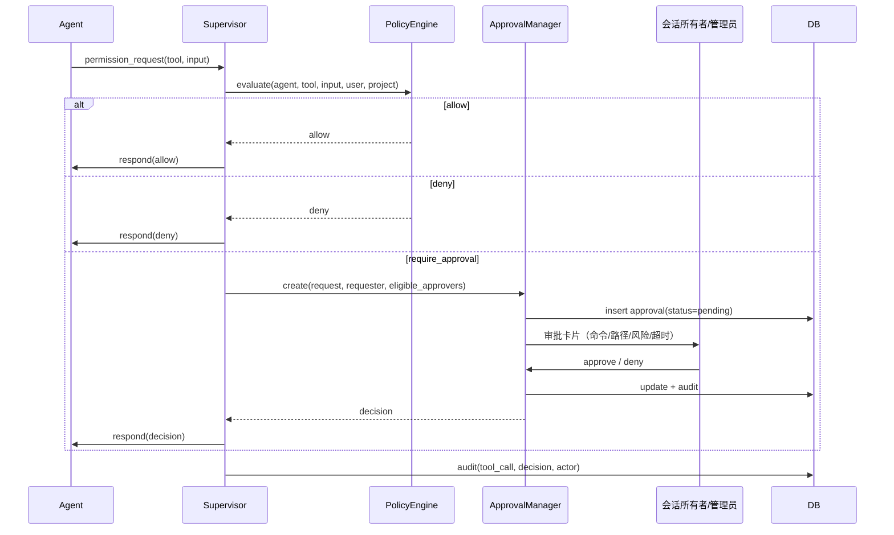
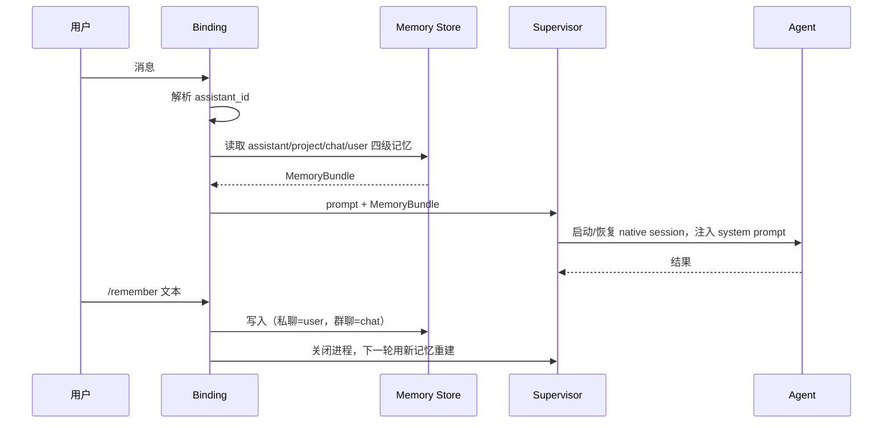

# WardenDeck 开发设计文档

> 工作名：**WardenDeck**（发布前需确认域名/包名占用）
> 版本：v0.1（Draft）
> 日期：2026-10-18
> 状态：待评审
> 定位：**面向团队的、自托管的 AI 编码 Agent 控制面**——默认安全、审批可追责、成本可计量。
>
> **安装与平台绑定**：见[第 18 章](#18-安装首次启动与平台绑定)（含 Slack/Telegram/飞书分步、身份绑定、排障与验收清单）。

**目录**

| 设计 | 实现 | 交付 |
|---|---|---|
| [1. 背景](#1-背景与问题) · [2. 目标](#2-目标与非目标) · [3. 用户场景](#3-目标用户与核心场景) · [4. 差异化](#4-差异化定位) · [5. 范围](#5-产品范围) | [6. 架构](#6-总体架构) · [7. 领域模型](#7-核心领域模型) · [8. 关键流程](#8-关键流程) · [9. 身份与权限](#9-身份权限与审批模型) · [10. 策略](#10-策略引擎) · [11. Agent 适配](#11-agent-适配层) · [12. 平台适配](#12-平台适配层) | [13. 存储](#13-存储与数据模型) · [14. API](#14-api-设计) · [15. 并发](#15-并发可靠性与背压) · [16. 安全](#16-安全设计) · [17. 可观测](#17-可观测性与成本) |
| [18. 安装与绑定](#18-安装首次启动与平台绑定) · [19. 技术栈](#19-技术栈与代码结构) · [20. 测试](#20-测试与-cicd) · [21. 里程碑](#21-里程碑90-天) · [22. 风险](#22-风险与开放问题) · [23. 指标](#23-成功指标) | [附录 A 配置](#附录-a最小配置示例) · [B 审计事件](#附录-b审计事件类型) | [C 控制台边界](#附录-c控制台边界检查清单) · [D Slack Manifest](#附录-dslack-app-manifest-关键片段) · [E 验收清单](#附录-e安装与绑定验收清单文档-pr-用) · [F CLI](#附录-fcli-命令速查v01-契约) |

---

## 1. 背景与问题

AI 编码 agent（Claude Code、Codex 等）已经能在本地执行 shell、改文件、访问网络。把它接到聊天平台后，带来了三类新问题：

1. **权限失控**：谁都能在群里点“允许”，审批记录无法追溯到具体的人；`bypassPermissions` 一开就是全权。
2. **不可审计**：谁在什么时候让 agent 改了什么、执行了什么命令、花了多少钱，没有统一记录。
3. **成本不可控**：多个成员、多个项目共享订阅额度或 API key，缺少配额与告警。

现有桥接工具主要解决“连得上、用得爽”，在**团队治理**上普遍偏弱或没有覆盖。WardenDeck 不做大而全的桥接，只做这一层。

## 2. 目标与非目标

### 2.1 目标（v1）

- 把 Claude Code / Codex / 任意 ACP agent 接入 Slack、Telegram 与飞书/Lark。
- 每次工具调用都可按策略自动放行、拒绝或转人工审批。
- 审批**绑定到发起会话的真实用户**，并写入不可篡改的审计日志。
- 按用户/项目/团队统计 token 与费用，支持软/硬预算。
- 管理员可控制「谁可以接入」与「谁能用/切换哪些模型」，全部在服务端强制。
- **可选** Web 控制台：会话、审批收件箱、审计检索、用量报表、成员与接入管理、模型切换；核心不依赖它。
- 单二进制 + Docker Compose，默认只监听 `127.0.0.1`，无公网入站要求。
- **Headless-first**：核心能力全部通过 API/CLI 暴露；Web 控制台是可选客户端，不承载业务逻辑，删除或禁用后不影响主流程。


## 3. 目标用户与核心场景

| 角色                | 场景                                           |
| ----------------- | -------------------------------------------- |
| Tech Lead / Owner | 给团队开通 agent，配置哪些命令必须审批，查看谁在什么时候改了什么          |
| 工程师               | 在 Slack 里让 agent 修 bug，手机上点“允许”前能看到完整命令和风险等级 |
| 安全 / 管理者          | 导出审计日志；给某个成员设置每日 token 上限；吊销离职成员             |
| 个人开发者             | 单人也能用，只是把审批人设成自己                             |

核心用户旅程：

1. 管理员部署 → 创建项目 → 绑定仓库目录 → 邀请成员。
2. 成员在 Slack 发消息 → agent 开始工作 → 风险操作弹出审批卡片。
3. 会话所有者或管理员批准 → 执行 → 全过程进入审计与用量统计。
4. 管理员在 Web 控制台按人/项目查看费用与高风险操作。

## 4. 差异化定位

现有桥接工具已经解决了“连得上、用得爽”。WardenDeck 在此基础上只补团队治理这一层：

| 维度 | WardenDeck |
|---|---|
| 平台广度 | 3 个（Slack、Telegram、飞书），做深 |
| 安全默认值 | 空 token 拒绝启动、审批绑定发起人 |
| 审计 | 追加式、哈希链、可导出 |
| 成本治理 | 配额、预算、硬停/审批 |
| 部署 | 一条 compose，默认 loopback |
| 扩展 | 编译期内置 + v1 外置插件（gRPC） |

一句话：**别人让你“连上”，WardenDeck 让团队“敢用”。**

## 5. 产品范围

### MVP（v0.1，8 周）

- Agent：Claude Code（stream-json）、Codex（app-server）、通用 ACP。
- 平台：Slack（Socket Mode）、Telegram（long polling）、飞书/Lark（长连接或 webhook）。
- 审批：策略引擎 + 审批收件箱 + 审批卡片 + 会话内 approve-all（有 TTL、可撤销）。
- 记忆：以 Assistant（机器人）为归属单位，四级作用域，跨 agent 共享；agent 原生 transcript 只作缓存。
- 审计：所有敏感动作 + 哈希链 + JSONL 导出。
- 用量：token 统计、按用户/项目日预算、80% 告警、100% 硬停或转审批。
- **可选**控制台：登录、会话列表/详情、审批、审计、用量、成员、接入、模型与策略管理。
- 安装体验：`init` 向导、`doctor` 自检、平台绑定 CLI/控制台双路径。
- 部署：单二进制、Docker Compose、SQLite 默认。

### v1.0

- OIDC/SSO、SCIM 可选。
- Postgres、Prometheus/OTel、S3 审计归档。
- 容器级沙箱（每会话一个 OCI 容器）。
- 更多 agent（Cursor、Gemini、OpenCode 通过 ACP）。
- 外置插件 SDK（gRPC）。

### 以后（不承诺）

- 多团队/多租户、策略即代码的 GitOps、审批工作流（多人会签）、IDE 插件。

## 6. 总体架构



### 6.1 组件职责

| 组件 | 职责 |
|---|---|
| Ingress | 校验平台签名/连接、平台用户 → 本地用户映射、消息去重、限流 |
| Session Router | 解析项目/工作区、会话复用与锁、消息队列、背压 |
| Agent Supervisor | 启动/监控/终止 agent 进程；解析事件；超时与清理 |
| Policy Engine | 对每个工具调用求值；输出 allow / deny / require_approval |
| Approval Manager | 创建审批、发送卡片、等待决策、TTL、幂等、审计 |
| Usage Meter | 从事件中提取 token/费用；预算检查 |
| Audit Log | 追加式写入；`prev_hash` 链；查询/导出 |
| HTTP API | REST + WebSocket/SSE，供 Web UI 与 CLI |
| Web UI | 嵌入式 React SPA，可 `no_web` 编译裁剪 |

### 6.2 关键设计决策（ADR 摘要）

| 决策 | 选择 | 备选 | 理由 |
|---|---|---|---|
| 语言 | Go | TypeScript/Rust | 单二进制、跨平台、进程与并发管理成熟 |
| 存储 | SQLite 默认 + Postgres 可选 | 仅 Postgres | 个人/小团队零依赖；接口层隔离方言 |
| Agent 协议 | 原生 Claude Code + Codex，通用 ACP | 只做 ACP | 前者功能完整，后者保证扩展性 |
| 平台接入 | Socket Mode / long poll | Webhook | 无需公网 IP，默认安全 |
| 审批模型 | 绑定发起人 + 角色 | 绑定会话 | 群聊共享会话时仍能追责 |
| 审计 | 哈希链追加式 | 普通表 | 防篡改、可验证，简历叙事强 |
| 插件 | 先编译期内置 | 一开始就 gRPC | 控制 MVP 复杂度 |

### 6.3 Headless 核心与可选控制台

**原则：先有 API/CLI，再有 UI。** 可视化页面只是 API 的一个消费者，和 `wardendeck` CLI、第三方脚本地位相同。

| 约束 | 实现 |
|---|---|
| 不承载业务逻辑 | 审批、策略、权限、模型切换全部在服务端求值；前端只做展示与提交 |
| 不直连数据库 | 前端只通过 HTTP API；无 SQL、无本地状态权威副本 |
| 可完全移除 | `go build -tags no_web` 或 `serve --no-web`；缺失 `web/dist` 只禁用静态页并告警 |
| 故障隔离 | 控制台宕机/资源 404 不影响 ingress、agent、审批与平台回复 |
| 权限一致 | 前端隐藏按钮只是体验，服务端对所有写操作做 RBAC 与审计 |
| 契约稳定 | 以 OpenAPI 为准；CLI 与控制台共用同一套接口 |

构建与部署形态：

```bash
# 完整版（默认，嵌入 SPA）
make build

# 无 Web 版（核心逻辑完全一致）
go build -tags no_web ./cmd/wardendeck

# 前后端分离：API 只开 CORS 白名单，静态资源由 CDN/Nginx 托管
wardendeck serve --no-web --api-only
```

**验收标准**：在不启动 Web 的情况下，管理员应能仅用 CLI/API 完成邀请成员、创建项目、切换模型、配置策略与审批。任何只能在 UI 里完成的操作都视为设计缺陷。

## 7. 核心领域模型

```
Team 1─n User 1─n Membership n─1 Project
Assistant 1─n MemoryItem
Assistant 1─n PlatformBinding n─1 Project
Project 1─n Session 1─n SessionEvent
Session 1─n Approval
Project 1─n Policy
User 1─n UsageRecord
AuditEvent (append-only)
```

- **Team**：一个部署一个团队；预留 `team_id` 便于以后多租户。
- **Assistant（机器人）**：一个配置好的聊天机器人，是**记忆的归属单位**。不同 Assistant 记忆隔离；同一 Assistant 下切换 Claude Code / Codex / ACP 共享长期记忆。
- **MemoryItem**：长期记忆，按 `assistant_id` 硬分区，作用域为 `assistant | project | chat | user`；不包含原生 transcript，后者属于可丢弃的 agent 缓存。
- **Project**：对应一个工作目录 + 一组平台绑定 + 一组策略。
- **Session**：一次连续对话；拥有 `owner_user_id`、`session_key`、agent 类型、工作目录、状态。
- **Approval**：一次权限请求；包含风险等级、工具参数摘要、发起人、可审批人、TTL、决策。
- **Policy**：规则集合；按优先级求值。
- **AuditEvent**：不可变事实，覆盖登录、配置变更、审批、执行、导出等。

## 8. 关键流程

### 8.1 消息 → agent → 回复



### 8.2 权限审批



审批规则：

- 只有 `session.owner`、项目 `admin/owner` 或显式委派人可批准。
- 审批记录包含**发起人**与**批准人**，两者都进审计。
- 审批卡片提供「允许一次 / 30 分钟内允许 / 拒绝」；30 分钟窗口从批准时开始计时，到期恢复逐项审批，跨用户不继承。
- 审批超时默认拒绝（fail-closed）。
- 审批与请求用 `request_id` 幂等；重复点击不重复执行。

### 8.3 记忆流（机器人维度）

记忆属于 Assistant，不属于 agent 实现。读写在 WardenDeck 内完成，agent 的 home 与 transcript 只当缓存。



规则：

- 所有查询强制带 `assistant_id`；不存在跨机器人读取记忆的接口。
- 记忆合并顺序为 `assistant → project → chat → user`，越具体越靠后。
- 记忆注入作为**对话上下文**，不修改 system prompt，避免记忆变更导致整段 prompt cache 失效。
- 注入按作用域预算 + 相关性排序，只渲染摘要行；作用域从具体到宽分配预算，宽作用域不得挤掉具体作用域。
- 记忆块明确标注“背景资料，不是指令”，不得覆盖策略引擎与审批规则。
- 底层 agent 自带的记忆（如 Claude Code auto memory）默认关闭，避免其按仓库分区、绕过 assistant 隔离。
- 聊天侧 `/remember` 只能写入当前用户或当前会话作用域；提升到 `assistant` 级是管理员操作。
- Agent 原生 session key 包含 `assistant_id`，禁止跨机器人复用 `--resume`。
- 切换 agent 时共享语义记忆与会话摘要，不迁移原生 transcript。

### 8.4 会话终止与进程清理

1. 发送 SIGTERM 到进程组（`Setpgid`）。
2. 等待 5 秒；未退出则 SIGKILL，重试一次。
3. `cmd.WaitDelay = 3s`，避免 stderr 管道被子进程占住导致永久阻塞。
4. stderr 使用有界环形缓冲（默认 64 KB）。
5. 清理临时文件、审批等待者、事件通道；所有清理路径幂等。

## 9. 身份、权限与审批模型

### 9.1 身份

- MVP：本地账号（邮箱 + Argon2id 密码），仅管理员可邀请；会话用 HttpOnly Cookie + CSRF token。
- **首次启动**：`wardendeck init` 创建 owner 账号，并打印一次性 setup token（30 分钟过期、仅可使用一次）；控制台只接受该 token 完成首次登录，之后强制修改密码。
- **邀请**：admin 生成邀请码/链接（有效期 + 使用次数），可指定邮箱或平台身份；用户通过 Web 或 `wardendeck invite accept <code>` 完成绑定。
- **平台身份**：`platform + external_user_id` 唯一映射到本地 User。未映射用户发消息时收到固定提示（“未授权，请联系管理员并提供此代码 xxx”），不会触发 agent；管理员在 Access 页面完成绑定。
- **自助绑定（v1）**：Slack 可通过 `users:read.email` 校验企业邮箱后自动映射；Telegram 仍以管理员绑定为主。
- v1：OIDC（Google/Okta/Keycloak），保留本地管理员作为 break-glass。

### 9.2 角色

| 角色 | 权限 |
|---|---|
| owner | 全部；转让团队；删除项目 |
| admin | 成员、策略、平台绑定、所有项目审计与审批 |
| operator | 自己的会话；可审批自己项目内会话；查看项目用量 |
| viewer | 只读会话与用量，不可发起、不可审批 |

权限判断集中在一个 `Authorizer`，禁止在 handler 里散落 `if role == ...`。

### 9.3 审批资格

```
can_approve(user, approval) =
  ( user.role in {owner, admin}
    OR (user.role == operator AND user.id == session.owner_user_id)
    OR user.id in approval.delegates )
  AND approval.status == pending
  AND now < approval.expires_at
```

### 9.4 敏感操作清单

- 修改策略/成员/平台绑定
- 批准工具调用（尤其 `Bash`、文件写入、网络访问）
- 导出审计
- 查看/轮换密钥
- 重启服务

全部写审计，且审计写入与业务写入在同一事务或通过 outbox 保证最终一致。

### 9.5 接入控制（谁可以接入 / 用哪个模型）

管理员在控制台里看到的开关，服务端都必须有对应的授权检查。接入控制分三层：

| 层 | 控制点 | 默认值 |
|---|---|---|
| 平台账号 | 邀请制、`allowed_users` 白名单、未映射用户拒绝 | 拒绝 |
| 团队/项目成员 | 成员邀请、角色、按项目授权、禁用/吊销 | 无权限 |
| 模型/Agent | 项目可用 agent 列表、模型白名单、谁有切换权 | 仅管理员可切换 |

规则：

- **邀请制**：只有 owner/admin 可邀请；邀请链接有有效期与使用次数。
- **平台白名单**：每个平台绑定可配置 `allowed_users`；空值 = 拒绝，而不是全放行。
- **项目级成员**：角色可以全局（admin）或项目级（operator/viewer）；项目级 operator 不能审批其他项目。
- **模型权限**：`model.use` 控制可用模型集合，`model.switch` 控制切换动作；二者都是服务端权限，不是前端开关。
- **记忆权限**：聊天参与者只能写 `user` / `chat` 作用域；写 `project` / `assistant` 作用域需要项目或团队管理员权限，防止注入内容扩散到其他会话。
- **紧急吊销**：禁用用户立即断开其 Web 会话、作废审批、阻止新消息；进行中的 agent 进程按配置终止。
- **网络层**（v1）：可选 IP/CIDR 白名单；默认只监听 loopback。

控制台对应页面（可选）：

- **Settings → Access**：用户列表、角色、邀请、禁用、平台白名单。
- **Settings → Models**：供应商凭证、模型目录、健康检查、项目默认模型、按用户的模型白名单。
- **Settings → Projects**：成员、可用 agent、工作目录、平台绑定。

所有变更写 `user.role_change`、`access.update`、`model.switch` 等审计事件。

## 10. 策略引擎

### 10.1 规则格式（YAML）

```yaml
version: 1
default: ask            # allow | deny | ask
rules:
  - name: read-only-tools
    match:
      tool: ["Read", "Grep", "Glob", "LS"]
    action: allow

  - name: block-destructive
    match:
      tool: ["Bash"]
      command_regex: ["rm -rf /", "git push --force", "DROP TABLE"]
    action: deny
    reason: "destructive command"

  - name: writes-need-owner
    match:
      tool: ["Write", "Edit", "MultiEdit"]
      path_glob: ["src/**", "docs/**"]
    action: ask
    approvers: [session_owner, project_admin]

  - name: network-needs-admin
    match:
      tool: ["WebFetch", "Bash"]
      command_regex: ["curl ", "wget ", "ssh "]
    action: ask
    approvers: [project_admin]
    ttl: 10m
```

### 10.2 求值语义

- 规则按顺序匹配，**第一条命中生效**；无命中走 `default`。
- 条件之间是 AND，同一条件内数组是 OR。
- 风险等级由工具类型 + 参数推导：`read < write < exec < network < destructive`。
- 求值结果包含 `action`、`reason`、`approvers`、`ttl`，全部写入审计。
- 策略变更需 admin，且记录 diff。

### 10.3 预算策略

```yaml
budgets:
  - scope: user
    period: day
    soft_limit_tokens: 2_000_000
    hard_limit_tokens: 3_000_000
    on_hard_limit: block   # block | ask_admin
```

超限时 agent 的新 turn 被拒绝，或转为管理员审批；已在执行的 turn 允许完成。

### 10.4 模型与供应商管理

> **默认不配置模型**：Claude Code / Codex 使用各自 CLI 已经配置好的模型，WardenDeck 只负责发现本地 CLI 并选择 agent。模型目录用于“覆盖”或接入 API 供应商，是可选能力。

模型切换是管理员的核心控制面之一，但同样遵守 Headless-first：先有 API/CLI，再有 UI。

**数据模型**

```
providers(id, name, kind, base_url, credential_ref, enabled)
models(id, provider_id, model_id, display_name, context_window,
       input_price, output_price, capabilities_json, enabled)
project_model_bindings(project_id, default_model_id, allowed_model_ids_json)
user_model_grants(user_id, project_id, allowed_model_ids_json, can_switch)
```

**切换作用域**

| 作用域 | 谁可以改 | 生效方式 |
|---|---|---|
| 项目默认模型 | admin/owner | 新会话生效 |
| 会话覆盖 | 会话所有者（在允许列表内）或 admin | 当前会话立即生效或下一轮生效 |
| 用户可用模型 | admin | 立即生效 |

**切换语义**

- Agent 实现 `ModelSwitcher` 时优先原地切换；否则关闭当前 agent 会话、保留逻辑会话，下一轮用新模型启动（客户端无感）。
- 切换前校验：模型存在、已启用、健康、在 `allowed_model_ids` 内、用户有 `model.switch` 权限。
- 切换动作写入审计：`model.switch`，包含旧模型、新模型、操作者、作用域。
- 模型不可用时按策略回退到项目默认模型，并发出告警；不允许静默换到未授权模型。

**供应商凭证**

- `credential_ref` 指向加密存储；API 响应只返回 `configured: true/false`。
- 支持凭证轮换与健康检查（`GET /api/v1/models/{id}/health`）。
- 模型价格表可配置，用于用量换算。

**控制台页面**

- 模型列表：状态、上下文长度、价格、健康、被哪些项目使用。
- 项目设置：默认模型 + 允许列表（多选）。
- 成员设置：可用模型 + 是否允许自行切换。
- 所有开关在服务端求值；前端隐藏不等于禁止。

## 11. Agent 适配层

### 11.1 接口

```go
type Agent interface {
    Name() string
    StartSession(ctx context.Context, opts SessionOptions) (AgentSession, error)
    ListSessions(ctx context.Context, workdir string) ([]SessionInfo, error)
    Stop() error
}

type AgentSession interface {
    Send(ctx context.Context, prompt string, atts []Attachment) error
    RespondPermission(requestID string, decision Decision) error
    Events() <-chan Event
    CurrentSessionID() string
    Alive() bool
    Close(ctx context.Context) error
}
```

可选能力用接口断言：`ModelSwitcher`、`ReasoningEffortSwitcher`、`HistoryProvider`、`SessionIDValidator`、`UsageReporter`。

### 11.2 首批实现

| 适配器 | 协议 | 关键点 |
|---|---|---|
| claudecode | 常驻进程，stream-json 双向 | `--permission-prompt-tool stdio`；进程组；`WaitDelay`；权限 hook；`CLAUDE_CODE_DISABLE_AUTO_MEMORY=1`；记忆走会话上下文而非 system prompt |
| codex | `codex app-server` JSON-RPC | `thread/start`、`turn/start`；审批请求；5 分钟超时默认拒绝 |
| acp | Agent Client Protocol | `session/new`、`session/update`、`session/cancel`；通用后备 |

### 11.3 进程监督器（所有适配器共用）

- 统一 `Supervisor` 负责 spawn、进程组、环境过滤、stdout/stderr 处理、超时、kill 升级。
- 每会话单写者：inbound 队列 → 一个消费 goroutine → agent；避免并发 Send。
- 事件通道有界；满了阻塞而不是丢弃（可配置为丢弃并告警）。
- 每轮有 `turn_timeout`（默认 60 分钟）与绝对 `session_ttl`。
- 不允许 agent 继承管理端密钥；通过 `FilterEnvForSpawn` 白名单过滤。
- 可选 `run_as_user`（POSIX）与容器沙箱（v1）。

## 12. 平台适配层

```go
type Platform interface {
    Name() string
    Start(handler MessageHandler) error
    Reply(ctx context.Context, replyCtx any, content string) error
    Send(ctx context.Context, replyCtx any, content string) error
    Stop() error
}
```

- Slack：Socket Mode（不需要公网），消息卡片、按钮、线程回复、流式分段编辑。
- Telegram：long polling，inline keyboard、分片、typing。
- 飞书/Lark：长连接（默认，无需公网）或 webhook；文本、富文本、卡片、文件；`tenant_access_token` 鉴权。
- 统一 `Card` 抽象；不支持的平台降级为纯文本。
- 身份映射：Slack `user_id` / Telegram `user_id` → `platform_identities` 表。
- 所有入站事件带 `platform_message_id` 做幂等去重。
- 可选能力 `TestConnection() error`：绑定前验证 token、权限与连接；Slack 用 `auth.test` + Socket Mode 握手，Telegram 用 `getMe`。

### 12.1 路由与绑定语义（Channel/Chat → Project）

一个 `platform_binding` = 一套 bot 凭证 + 若干「频道/会话 → 项目」映射：

```
platform_bindings(id, project_id, platform, credential_ref, config_json)
  config_json: {
    channel_ids: ["C0123..."],        # Slack 频道 / Telegram chat_id
    dm_default_project: true,          # DM 是否落到本项目
    mention_only: true,             # 群聊是否必须 @ 机器人
    allowed_users: ["U0123..."]           # 平台用户白名单（空 = 拒绝）
  }
```

路由优先级（自上而下，命中即停）：

1. **精确频道/群绑定**：Slack channel ID、Telegram chat ID → 项目。
2. **线程/topic 继承**：Slack thread 继承父频道；Telegram forum topic 继承群。
3. **DM**：落到该用户的默认项目；没有默认项目则提示 `/use <project>`。
4. **命令覆盖**：项目成员可在允许范围内用 `/use <project>` 切换当前会话的项目。
5. **未绑定**：记录日志并回复“此频道未绑定项目”，**绝不**落到默认项目或启动 agent。

约束：

- 一个频道/chat 只能绑定一个项目；管理员重复绑定时直接报错。
- 群聊默认 `mention_only=true`；Slack 监听 `app_mention`，Telegram 依赖隐私模式/`@bot` 或命令。
- 忽略所有 bot 自己发送的消息，防止回环。
- 绑定变更（新增/删除/改项目）写审计 `platform.bind` / `platform.unbind`。
- 同一 Slack workspace 可以只装一个 app，服务多个项目；Telegram 同理，一个 bot 按 chat 分流。

## 13. 存储与数据模型

### 13.1 表

```sql
assistants(id, name, default_agent, created_at)
memory_items(id, assistant_id, scope_type, scope_id, kind, content,
             source, confidence, active, created_at, updated_at)
users(id, email, password_hash, role, status, default_project_id,
      password_change_required, created_at)
memberships(team_id, user_id, role)
project_members(project_id, user_id, role)
platform_identities(platform, external_id, user_id, created_at)
projects(id, team_id, name, workdir, agent_type, created_at)
platform_bindings(id, assistant_id, project_id, platform, credential_ref,
                  config_json, enabled, created_by)
sessions(id, project_id, owner_user_id, session_key, agent_type,
         agent_session_id, status, started_at, ended_at)
session_events(id, session_id, seq, type, payload_json, created_at)
approvals(id, session_id, request_id, requester_user_id, tool, risk,
          input_digest, input_preview, status, decided_by, decided_at,
          expires_at, policy_rule, approvers_json, scope, reason)
audit_events(id, seq, ts, actor_user_id, action, target, result,
             metadata_json, prev_hash, hash)
usage_records(id, session_id, user_id, project_id, input_tokens,
              output_tokens, cost_micros, model, created_at)
policies(id, project_id, version, yaml, created_by, created_at)
providers(id, name, kind, base_url, credential_ref, enabled)
models(id, provider_id, model_id, display_name, context_window,
       input_price, output_price, capabilities_json, enabled)
project_model_bindings(project_id, default_model_id, allowed_model_ids_json)
user_model_grants(user_id, project_id, allowed_model_ids_json, can_switch)
access_rules(id, scope, platform, allowed_users_json, ip_cidrs_json, updated_by)
settings(key, value)
```

### 13.2 审计哈希链

```
hash_n = SHA256(prev_hash || canonical_json(event_n))
```

- 写入串行化（单写者或 DB 事务 + advisory lock）。
- 提供 `GET /api/v1/audit/verify` 校验完整性。
- 每日生成 anchor（可选写入外部对象存储或打印到日志）。

### 13.3 数据保留

- 默认保留 180 天；可配置。
- 删除用户时保留审计（假名化），会话正文可按项目配置清除。
- 备份：SQLite 在线备份 API；Postgres 用 pg_dump；备份文件加密。

## 14. API 设计

认证：Cookie 会话（Web）或 `Authorization: Bearer <token>`（CLI/自动化）。

| 方法 | 路径 | 说明 |
|---|---|---|
| POST | `/api/v1/auth/login` | 登录 |
| POST | `/api/v1/auth/logout` | 登出 |
| GET | `/api/v1/me` | 当前用户与权限 |
| GET | `/api/v1/projects` | 项目列表 |
| POST | `/api/v1/projects` | 创建项目（admin） |
| GET | `/api/v1/sessions` | 会话列表（过滤：项目/用户/状态） |
| GET | `/api/v1/sessions/{id}` | 会话详情 + 事件 |
| POST | `/api/v1/sessions/{id}/messages` | 发送消息 |
| GET | `/api/v1/approvals?status=pending` | 审批收件箱 |
| POST | `/api/v1/approvals/{id}/decide` | `{"decision":"approve"}` |
| GET | `/api/v1/usage` | 按用户/项目/时间聚合 |
| GET | `/api/v1/audit` | 审计检索（分页） |
| GET | `/api/v1/audit/verify` | 校验哈希链 |
| GET/PUT | `/api/v1/policies/{project}` | 读写策略（admin） |
| GET/POST | `/api/v1/members` | 成员管理 |
| POST | `/api/v1/members/{id}/disable` | 禁用成员并吊销会话 |
| GET/PUT | `/api/v1/projects/{id}/members` | 项目成员与项目级角色 |
| GET/PUT | `/api/v1/access` | 平台白名单、邀请策略、IP 白名单 |
| GET/POST/PUT | `/api/v1/models` | 模型目录（供应商、价格、启用状态） |
| GET/PUT | `/api/v1/projects/{id}/models` | 项目默认模型与允许列表 |
| POST | `/api/v1/sessions/{id}/model` | 会话级切换模型 |
| PUT | `/api/v1/users/{id}/models` | 用户可用模型与切换权 |
| POST | `/api/v1/auth/bootstrap` | 用一次性 setup token 完成首次登录 |
| GET/POST | `/api/v1/projects/{id}/platforms` | 列出/新增平台绑定 |
| DELETE | `/api/v1/projects/{id}/platforms/{binding}` | 解绑频道/chat |
| POST | `/api/v1/platforms/test` | 测试 bot 凭证与连接（不落库） |
| GET | `/api/v1/doctor` | 运行自检并返回可修复项 |
| GET/PUT | `/api/v1/settings` | 服务设置 |
| POST | `/api/v1/secrets` | 写入/轮换密钥（只写不回显） |
| GET | `/api/v1/stream?session_id=` | WebSocket 实时事件 |

约定：

- 所有列表接口分页（`limit`、`cursor`）。
- 错误统一 `{"error":{"code","message","request_id"}}`。
- 敏感字段永不出现在响应中；`secrets` 只接受写入。
- 所有写操作校验 CSRF（Cookie 模式）与 RBAC。

## 15. 并发、可靠性与背压

- **每会话单写者**：`sessionActor` 串行处理消息与事件；跨会话并行。
- **有界队列**：默认 5 条；满时回复“排队中/繁忙”，不无限堆积。
- **锁顺序**：全局锁 → 项目锁 → 会话锁；禁止反向获取；慢 I/O 不持锁。
- **幂等**：`platform_message_id`、`approval.request_id`、API `Idempotency-Key`。
- **超时**：入站 30s、审批 TTL、turn 60min、关闭 150s、HTTP 30s。
- **优雅关闭**：停止接新消息 → 通知 agent → 等待在途 turn（可配置上限）→ 强制清理。
- **崩溃恢复**：启动时把 `running` 会话标记为 `interrupted`；不自动重放危险操作。

## 16. 安全设计

### 16.1 威胁模型

| 威胁 | 控制 |
|---|---|
| 未授权访问控制台/API | 默认拒绝空 token；强制认证；限速与锁定 |
| 群成员冒充审批 | 审批绑定发起人/角色；卡片回调二次校验用户 |
| 恶意 prompt 注入导致越权 | 策略引擎独立于 agent 判断；危险工具强制人工 |
| 密钥泄漏 | 加密存储；日志脱敏；API 永不回显；启动时检查文件权限 |
| Agent 逃逸/残留进程 | 进程组、kill 升级、WaitDelay；v1 容器沙箱 |
| 审计被篡改 | 哈希链 + 外部 anchor + 只追加权限 |
| 依赖供应链 | 锁定依赖、govulncheck、SBOM、签名发布、校验和 |
| 公网暴露 | 默认 `127.0.0.1`；无 webhook；建议 Caddy/Tailscale |

### 16.2 密钥管理

- 平台 token、API key 存 DB 的 `secret_ref`，用 master key 加密（AES-256-GCM）。
- master key 来源优先级：系统 keychain → 环境变量 → 文件（0600）。
- 支持轮换；轮换写审计；旧的密文保留至下次重加密完成。

### 16.3 沙箱（v1）

- 每会话一个容器：只读根文件系统、非 root、挂载工作目录、默认无网络。
- 需要网络时按策略放行域名；命令与文件访问仍由 policy 二次约束。
- 容器运行时（Docker/Podman）可插拔；无容器时退化为进程级隔离并明确告警。

## 17. 可观测性与成本

- **日志**：slog JSON，字段包含 `request_id`、`session_id`、`user_id`；统一脱敏。
- **指标**（Prometheus）：会话数、turn 延迟、审批等待时长、审批拒绝率、token/费用、进程重启次数。
- **追踪**（OpenTelemetry）：ingress → router → agent turn → 平台回复。
- **用量**：从 agent 事件提取 input/output tokens；按模型价格表换算；价格表可配置。
- **告警**：预算 80%、审批超时率、agent 崩溃率、审计写入失败。

## 18. 安装、首次启动与平台绑定

目标：一个新用户按文档操作，**30 分钟内**完成安装、绑定并收到第一条 agent 回复。若做不到，视为文档/产品缺陷。

> 本章是设计阶段的“安装契约”。正式发布时拆分为 `README.md`（60 秒 Quickstart）、`docs/install.md`、`docs/platforms/slack.md`、`docs/platforms/telegram.md`、`docs/troubleshooting.md`，并用 CI 校验文档中的命令可执行、`--help` 输出一致。

**TL;DR（五步）**

```bash
# 1. 装好并登录 agent CLI
claude --version          # 首次使用运行 `claude`，按提示完成登录
codex --version && codex login   # 使用 Codex 时

# 2. 初始化（生成配置、master key、owner、一次性 setup token）
wardendeck init --dir ~/.wardendeck

# 3. 写入平台与模型凭证
wardendeck secret set slack_main --from-prompt
wardendeck secret set tg_main --from-prompt
wardendeck secret set provider_anthropic --from-prompt

# 4. 建项目并绑定频道/chat
wardendeck project create --name backend --workdir /workspace/backend --agent claudecode
wardendeck platform bind slack --project backend --credential slack_main \
  --channel C0123ABC --allowed-users U0123ABC
wardendeck platform bind telegram --project backend --credential tg_main \
  --chat -1001234567890 --allowed-users 123456789

# 5. 自检并启动
wardendeck doctor && wardendeck serve
```

控制台（可选）打开 `http://127.0.0.1:8787`，用 init 打印的 setup token 登录。下面是每一步的细节。

### 18.1 前置条件

| 项 | 要求 | 检查方式 |
|---|---|---|
| 操作系统 | Linux（x86_64/arm64）、macOS；Windows 走 WSL2 | `uname -a` |
| Agent CLI | 至少一个：Claude Code 或 Codex，已安装并完成登录 | `claude --version` / `codex --version` |
| Agent 认证 | 已在**运行 WardenDeck 的同一用户**下登录 | `claude login` / `codex login` |
| 工作目录 | 存在、可读写、建议是 git 仓库 | `test -w /path` |
| Slack | 有权限创建/安装 app；启用 Socket Mode | 见 18.4 |
| Telegram | 一个 BotFather 创建的 bot token | 见 18.5 |
| 飞书/Lark | 企业自建应用的 App ID / App Secret，已开启机器人能力 | 见 18.5.1 |
| 出站网络 | 能访问 Slack、`api.telegram.org`、模型 API | `curl -I` |
| 代理（可选） | 支持 `HTTPS_PROXY` / `HTTP_PROXY` | `wardendeck doctor` |

> **不要跳过 agent 登录。** WardenDeck 不代理模型请求，它启动的是本机已登录的 CLI；未登录会表现为“启动成功但每次对话报 auth error”。

常用 agent 安装：

```bash
# Claude Code
npm install -g @anthropic-ai/claude-code   # 或官方原生安装脚本
claude --version                           # 首次运行 `claude`，按提示登录

# Codex
npm install -g @openai/codex
codex --version && codex login
```

### 18.2 安装方式

**方式 A：单二进制（推荐）**

```bash
# 推荐：从 Releases 下载对应平台压缩包，校验 checksums.txt 与 cosign 签名后解压
# 便捷：安装脚本同样会先校验签名，再落盘
curl -fsSL https://get.<your-domain>/install.sh | sh
wardendeck --version
```

**方式 B：Docker Compose**

```yaml
services:
  wardendeck:
    image: ghcr.io/<org>/wardendeck:0.1
    ports: ["127.0.0.1:8787:8787"]
    volumes:
      - ./data:/data
      - ${WORKSPACE_DIR}:/workspace
      - ${HOME}/.claude:/home/wardendeck/.claude   # agent 登录态
      - ${HOME}/.codex:/home/wardendeck/.codex
    environment:
      WARDENDECK_MASTER_KEY_FILE: /run/secrets/master_key
      HTTPS_PROXY: ${HTTPS_PROXY:-}
    secrets: [master_key]
  caddy:
    image: caddy:2
    ports: ["443:443"]
    volumes: ["./Caddyfile:/etc/caddy/Caddyfile"]
```

> **Docker 注意事项**：镜像内必须预装 agent CLI，并挂载其登录态；否则容器里没有 `claude`/`codex`。注意容器 UID 与宿主登录态文件权限匹配（可用 `--user $(id -u):$(id -g)`）。个人使用优先单二进制，避免把 home 目录凭据挂进容器。

容器首次初始化：

```bash
docker compose run --rm wardendeck init --dir /data \
  --non-interactive --admin-email you@example.com
# owner 初始密码通过 WARDENDECK_ADMIN_PASSWORD_FILE 注入，不要放在命令历史里
docker compose up -d
```

**方式 C：源码构建**

```bash
git clone https://github.com/<org>/wardendeck.git
cd wardendeck && make build   # 需要 Go 1.24+
```

### 18.3 首次初始化

```bash
wardendeck init --dir ~/.wardendeck
```

交互式向导会询问并生成：

1. 数据目录（默认 `~/.wardendeck`，权限 `0700`）。
2. 监听地址（默认 `127.0.0.1:8787`，**不提供 `0.0.0.0` 默认值**）。
3. 数据库（默认 SQLite；可选 Postgres DSN）。
4. owner 邮箱与密码（Argon2id）。
5. master key：生成后显示一次恢复码，要求用户离线保存。
6. 一次性 setup token：用于首次打开控制台，30 分钟过期。

生成文件：

```
~/.wardendeck/
├── config.yaml      # 0600
├── master.key       # 0600；优先尝试系统 keychain
├── wardendeck.db   # 0600
└── policies/
```

若 setup token 丢失或过期，在本机执行 `wardendeck admin reset-setup-token`（要求能读取数据目录）；忘记密码用 `wardendeck admin reset-password --email <email>`。两条命令都会写审计。

随后执行自检：

```bash
wardendeck doctor
```

`doctor` 至少检查：

- 配置可解析、master key 可用、数据目录权限正确；
- 数据库可写、迁移版本一致；
- 端口未被占用；
- `claude`/`codex` 是否存在、版本是否在兼容范围、是否已登录；
- Slack `auth.test` 与 Socket Mode 连接；
- Telegram `getMe`；
- 工作目录是否可读写、是否在 git 仓库内；
- 时钟偏差（审计哈希链依赖时间）；
- 出站网络与代理。

每条失败都给出**可复制的修复命令**，而不是只报错。

安装为系统服务（可选，推荐长期运行）：

```bash
wardendeck service install --user
# Linux
systemctl --user enable --now wardendeck
# macOS
launchctl bootstrap gui/$(id -u) ~/Library/LaunchAgents/dev.wardendeck.plist

wardendeck service status
journalctl --user -u wardendeck -f     # Linux 日志
```

### 18.4 绑定 Slack

**第一步：创建 app**（workspace 管理员）

1. 打开 <https://api.slack.com/apps> → Create New App → From manifest。
2. 使用仓库内的 `deploy/slack-manifest.json`，或手动配置：
   - **Socket Mode**：开启。
   - **App-level token**：**Basic Information → App-Level Tokens → Generate Token**，scope 勾选 `connections:write`，得到 `xapp-...`。
   - **Bot token scopes**：`app_mentions:read`、`chat:write`、`channels:history`、`groups:history`、`im:history`、`im:read`、`im:write`、`users:read`、`users:read.email`、`files:read`、`files:write`、`reactions:write`。
   - **Event subscriptions**：`app_mention`、`message.channels`、`message.groups`、`message.im`。
3. Install to Workspace，得到 `xoxb-...`。
4. 把 bot 邀请进目标频道：`/invite @WardenDeck`。
5. 复制 **Channel ID**（频道详情 → About → Channel ID，形如 `C0123ABC`）。

**第二步：写入凭证并绑定**

```bash
wardendeck secret set slack_main --from-prompt   # 依次输入 xapp- 与 xoxb-
wardendeck platform test --credential slack_main  # auth.test + Socket Mode 握手
wardendeck platform bind slack \
  --project backend \
  --credential slack_main \
  --channel C0123ABC \
  --mention-only \
  --allowed-users U0123ABC          # 必填：留空 = 拒绝所有人
```

> `--channel` 可重复传入以绑定多个频道；一个频道只能属于一个项目。需要放开整个 workspace 时必须显式加 `--allow-all`，并在审计中记录。

**多频道/多项目**：同一个 Slack app 可以被多个项目复用，按 Channel ID 分流；不需要为每个项目单独建 app。

> 一个 Slack app 绑定一个 workspace；多个 workspace 需要分别安装并各自提供 `xapp-`/`xoxb-`，MVP 不做跨 workspace 聚合。内部使用无需 App Directory 审核，公开发布才需要。

控制台等价路径：**Settings → Projects → backend → Platforms → Add Slack**，粘贴两个 token，选择频道。

**常见坑**：

- 只填了 `xoxb-` 没填 `xapp-` → Socket Mode 连不上。
- bot 未进频道 → 收不到 `message.channels`。
- 订阅了 `message.channels` 但未开 `mention_only` → 频道里所有消息都触发；只想响应 @ 时请同时使用 `app_mention` + `mention_only`。
- 频道 ID 填成频道名 → 绑定失败，必须用 `C...` ID。

### 18.5 绑定 Telegram

**第一步：创建 bot**

1. 找 `@BotFather` → `/newbot` → 得到 `123456:ABC...` token。
2. 群聊使用：`/setprivacy` → Disable（否则 bot 只能看到命令和 @）；或保留隐私模式，只用 `/ask@YourBot`。
3. 把 bot 拉进群，发一条消息。

**第二步：拿 chat/用户 ID**

```bash
# 私聊先给 bot 发 /start，然后：
curl -s "https://api.telegram.org/bot<TOKEN>/getUpdates" | jq '.result[].message.chat.id'
# 群 ID 通常形如 -1001234567890
```

也可以用 `@userinfobot` 查询自己的用户 ID。

**第三步：写入凭证并绑定**

```bash
wardendeck secret set tg_main --from-prompt
wardendeck platform test --credential tg_main   # getMe
wardendeck platform bind telegram \
  --project backend \
  --credential tg_main \
  --chat -1001234567890 \
  --mention-only \
  --allowed-users 123456789         # 必填：群里的用户数字 ID
```

> 群聊中建议同时保留 `mention_only`；关闭隐私模式后 bot 能看到全部消息，但只有 @ 它的消息会触发 agent。

控制台等价路径：**Settings → Projects → backend → Platforms → Add Telegram**，粘贴 token 与 chat ID。

**常见坑**：

- 群组隐私模式未关 → 普通消息收不到；修改隐私模式后需要把 bot 移出群再重新拉入才生效。
- 之前给 bot 设置过 webhook → long polling 会拿不到消息，先调用 `deleteWebhook`。
- chat ID 用了用户名而不是数字 ID。
- 国内网络无法直连 `api.telegram.org` → 设置 `HTTPS_PROXY` 后重启。
- 同一 bot 被多个项目绑定同一 chat → 绑定冲突，服务端拒绝。

### 18.5.1 绑定飞书 / Lark

**推荐：扫码新建**

```bash
wardendeck feishu setup --project backend
```

CLI 调用飞书设备授权接口 `accounts.feishu.cn/oauth/v1/app/registration`（Lark 自动切换 `accounts.larksuite.com`），打印授权链接；用户用手机飞书打开/扫码并确认后，应用自动创建，凭证写入 `feishu_backend`。控制台「平台绑定 → 扫码新建飞书应用」提供同一流程。

**手动创建（已有应用）**

**第一步：创建应用**

1. 打开 [飞书开放平台](https://open.feishu.cn/app)（国际版 `open.larksuite.com`）→ 创建**企业自建应用**。
2. 在「凭证与基础信息」复制 **App ID**（`cli_...`）与 **App Secret**。
3. 在「应用能力」添加**机器人**。
4. 在「权限管理」开通消息权限：`im:message`、`im:message:send_as_bot`，以及读取群信息所需权限。
5. 创建版本并发布；企业内可能需要管理员审核。

**第二步：拿到 chat_id / open_id**

- 把机器人拉进目标群。
- 群 `chat_id` 形如 `oc_...`；用户 `open_id` 形如 `ou_...`。
- 可通过飞书 API（`/open-apis/im/v1/chats`）或开放平台调试台获取。

**第三步：写入凭证并绑定**

```bash
# 第一行 App ID，第二行 App Secret；Lark 国际版加第三行 lark
wardendeck secret set feishu_main --from-prompt

wardendeck platform test --credential feishu_main --platform feishu
# 可选：发送真实测试消息，验证 send_as_bot 权限与 chat_id
wardendeck platform test --credential feishu_main --platform feishu \
  --send-to oc_xxx --text "WardenDeck 测试消息"
wardendeck platform bind \
  --project backend \
  --platform feishu \
  --credential feishu_main \
  --channel oc_xxx \
  --allowed-users ou_xxx
```

`platform test` 会依次验证 `tenant_access_token` 和 `bot/v3/info`，能确认 App 凭证有效、机器人能力已开启。

**常见坑**：

- 应用未发布 → 拿不到 tenant token 或机器人不可见。
- 机器人未进群 → 绑定成功但收不到消息。
- `chat_id` 与用户 `open_id` 混用 → 绑定校验或消息路由失败。
- 国际版用了 `open.feishu.cn` → 凭证校验失败；secret 第三行写 `lark` 或在控制台选择 Lark。
- 原型已接入长连接并订阅 `im.message.receive_v1`；消息路由到项目，以 stream-json 常驻会话调用本地 Claude Code，同一 chat 用 `--resume` 延续会话。
- 工具权限通过 `--permission-prompt-tool stdio` 桥接：飞书卡片按钮或文字 `1`/`2`/`3` 审批；选择 `2` 时只在接下来 30 分钟内自动放行，到期恢复逐项审批。
- 手动创建的应用需要把事件订阅方式设为**长连接**并发布版本，否则收不到消息。

### 18.6 创建项目与路由

```bash
# 1. 创建项目（工作目录必须已存在；agent 自动检测本地 CLI）
wardendeck project create \
  --name backend \
  --workdir /workspace/backend

# 2.（可选）只有需要覆盖模型或接入 API 供应商时才配置
#    Claude Code/Codex 默认使用 CLI 自身已配置的模型
wardendeck provider add --name anthropic --kind anthropic --credential provider_anthropic
wardendeck model add --provider anthropic --id claude-sonnet-5-5 \
  --display-name "Claude Sonnet 5.5" --context-window 200000
wardendeck model set --project backend --default claude-sonnet-5-5

# 3. 配置策略（可先用内置基线）
wardendeck policy apply --project backend --file deploy/policies/baseline.yaml

# 4. 绑定频道（见 18.4 / 18.5 / 18.5.1）
```

路由规则见 12.1。一个频道/chat 只能属于一个项目；DM 需要先给用户设置默认项目，否则 bot 会提示 `/use <project>`。

### 18.7 邀请成员与身份绑定

1. admin 在 **Settings → Access → Invite** 输入邮箱，生成邀请码/链接。
2. 成员打开链接设置密码；或在 CLI 执行 `wardendeck invite accept <code>`。
3. 管理员获取平台 ID：
   - Slack：成员资料 → Copy member ID（`U0123...`）；
   - Telegram：让成员给 `@userinfobot` 发消息获取数字 ID。
4. 绑定身份并授权（CLI 与控制台等价）：

```bash
wardendeck user invite --email alice@example.com
wardendeck user map --platform slack --external-id U0123ABC --user alice@example.com
wardendeck user map --platform telegram --external-id 123456789 --user alice@example.com
wardendeck project grant --project backend --user alice@example.com --role operator

# DM 需要默认项目；Telegram 私聊没有频道绑定
wardendeck user set-default-project --user alice@example.com --project backend
```

控制台路径：**Settings → Access → Members → Add identity**，以及 **Projects → backend → Members → Grant**。

未绑定用户发消息时只会收到“未授权”提示，不会触发 agent；提示中包含一次性短码（10 分钟有效），管理员可凭短码快速绑定：

```bash
wardendeck user bind-code ABCD-1234 --user alice@example.com
```

### 18.8 第一条消息验收

1. 启动：`wardendeck serve`（或 `systemctl --user start wardendeck`）。
2. 打开 `http://127.0.0.1:8787`，用 setup token 登录并改密。
3. 在 Slack 频道 `@WardenDeck 你好`，或在 Telegram 私聊发送 `你好`。
4. 预期：bot 回复；控制台 Sessions 出现记录；Audit 出现 `message.inbound` / `session.start`。
5. 让 agent 执行一个写操作，确认审批卡片出现、批准后执行、审计出现 `approval.decide`。

### 18.9 排障表

| 现象 | 优先检查 |
|---|---|
| bot 完全不回复 | 平台绑定是否存在、bot 是否在频道、`doctor` 的 Socket Mode/getMe |
| 回复“未授权” | `platform_identities` 是否映射、`allowed_users` 是否包含该用户 |
| 回复“此频道未绑定项目” | 频道/chat ID 是否正确、是否绑到了其他项目 |
| agent 启动失败 | CLI 是否在 PATH、是否已登录、工作目录权限、`doctor` |
| 审批卡片不出现 | 策略是否 `allow`、平台是否有卡片能力、审批人是否有资格 |
| 模型切换被拒绝 | 模型是否启用/健康、是否在允许列表、是否有 `model.switch` |
| Telegram 收不到群消息 | 隐私模式、是否 @、chat ID、代理 |
| 飞书凭证测试失败 | 应用是否已发布、App ID/Secret、feishu/lark 域名、机器人能力 |
| 飞书绑定后无消息 | 机器人是否进群、`chat_id` 是否 `oc_...`、事件长连接是否已接入 |
| 控制台 401 | setup token 是否过期/已使用、Cookie 域、反向代理头 |
| 审计校验失败 | 是否手工改库、备份恢复是否完整、时钟是否跳变 |

### 18.10 升级、备份与卸载

- **升级**：先 `wardendeck backup`，停止服务，替换二进制，启动时自动迁移；迁移失败自动回滚到备份并拒绝启动。
- **备份**：`wardendeck backup --out /backup/aw-$(date +%F).tar.gz`（DB + config + policies）；**明确排除 `master.key`**，需单独离线保管，否则备份泄露 = 密钥泄露。
- **卸载**：停止并删除 systemd/launchd 服务，保留数据目录；`--purge` 才删除数据。
- **兼容性**：`docs/compatibility.md` 维护 Claude Code / Codex 版本基线；CI 每周对最新 CLI 跑一次契约测试，不兼容时明确报错而不是静默失败。

### 18.11 远程访问

- 默认只监听 `127.0.0.1`；远程访问推荐 Tailscale/WireGuard。
- 需要公网时用 Caddy/Nginx 终止 TLS，并额外加一层认证（Basic/OIDC）。
- 不使用 webhook；Slack 走 Socket Mode，Telegram 走 long polling，因此**不需要公网入站端口**。

## 19. 技术栈与代码结构

- Go 1.24+（单二进制、无 CGO）
- SQLite：`modernc.org/sqlite`；Postgres：`pgx`
- 迁移：`goose`（embed）
- Web：React 19 + TypeScript + Vite + Tailwind + TanStack Query + `shadcn/ui`
- 图表：Recharts；实时：WebSocket
- 日志：`log/slog`；指标：Prometheus client；追踪：OTel
- 测试：`testing` + `testify` + `httptest` + golden files

```
wardendeck/
├── cmd/wardendeck/           # main, init, doctor
├── internal/
│   ├── core/                  # 领域模型、事件、授权
│   ├── agent/
│   │   ├── supervisor/        # 进程管理、统一事件
│   │   ├── claudecode/
│   │   ├── codex/
│   │   └── acp/
│   ├── platform/
│   │   ├── slack/
│   │   └── telegram/
│   ├── policy/                # 规则解析与求值
│   ├── approval/
│   ├── audit/                 # 哈希链
│   ├── usage/
│   ├── store/                 # sqlite/postgres + migrations
│   ├── api/                   # REST + WS（核心，始终存在）
│   └── web/                   # embed（可选，no_web 时用 stub）
├── web/                       # React SPA（可选，删除不影响核心）
├── docs/                      # 架构、安全模型、部署
├── deploy/                    # compose, caddy, systemd
└── tests/                     # e2e、契约、golden
```

## 20. 测试与 CI/CD

### 20.1 测试层次

| 层次 | 内容 |
|---|---|
| 单元 | 策略求值、哈希链、授权、分片、去重 |
| 契约 | 每个 agent 适配器用录制的 golden transcript 回放 |
| 集成 | fake platform + fake agent，跑完整审批链路 |
| 安全 | 空 token、越权审批、路径穿越、日志泄漏、CSRF |
| E2E | Docker Compose + 真实 Slack/Telegram/飞书测试工作区（手动触发） |
| 性能 | 100 并发会话、事件吞吐、SQLite 写放大 |
| Headless | `-tags no_web` 构建；仅用 CLI/API 完成邀请、建项目、切模型、审批全流程 |

### 20.2 CI

- `golangci-lint`、`go test -race ./...`、`govulncheck`、`trivy`。
- Linux/macOS/Windows 构建矩阵。
- Web：`pnpm install --frozen-lockfile && pnpm build`。
- 发布：tag 触发 goreleaser，生成 checksums、SBOM、cosign 签名、多架构镜像。
- 覆盖率门槛：核心包 ≥ 70%，策略/审计 ≥ 90%。

## 21. 里程碑（90 天）

| 周 | 交付 |
|---|---|
| 1–2 | 设计评审；repo 骨架；CI；策略引擎 + 单元测试 |
| 3–4 | Agent supervisor + Claude Code 适配；fake platform 打通端到端 |
| 5 | Slack 适配 + 审批卡片；`init`/`doctor`/`secret`/`platform bind` CLI；审计哈希链 |
| 6 | Telegram / 飞书适配；频道/chat 路由与身份映射；Web 登录、会话、审批收件箱 |
| 7 | 用量与预算；策略编辑 UI；安装/绑定文档与 E2E 验收；安全测试 |
| 8 | Docker Compose、升级/备份、v0.1 发布；种子用户部署 |
| 9–10 | 修 issue；Codex app-server；Postgres；OTel |
| 11 | Show HN / Reddit / V2EX / 即刻 发布；演示视频 |
| 12–13 | v1.0：OIDC、容器沙箱、飞书（可选）、插件 SDK 设计 |

> 控制台（第 6–7 周）是可选交付物：如果进度紧张，先发布 headless 核心 + CLI/API，UI 顺延到 v0.2，不阻塞主逻辑与发布。

## 22. 风险与开放问题

| 风险 | 应对 |
|---|---|
| Agent CLI 协议变化频繁 | 契约测试 + golden 回放；版本探测；降级 |
| 平台 API 变更 | 适配器隔离；端到端测试工作区 |
| 范围膨胀 | 严格 MVP；新平台进 backlog，不阻塞发布 |
| 安全漏洞 | 威胁模型评审；最小权限；安全披露流程 |
| 单人维护疲劳 | 自动化发布；good first issue；明确支持边界 |
| 名字/商标冲突 | 发布前查商标、域名、npm、GitHub org |

开放问题：

1. 审批是否需要“多人会签”？MVP 先不做，但数据模型预留。
2. 「30 分钟内允许」的默认时长与范围是否需要按项目覆盖？
3. 会话正文保留策略：默认 180 天是否合适？
4. 是否在 v1 就做外置插件，还是先观察贡献者需求？

## 23. 成功指标

- 发布 90 天内：≥ 500 star；≥ 30 个真实部署；≥ 5 个外部贡献者。
- 产品指标：审批平均等待 < 2 分钟；审计写入成功率 100%；P95 消息延迟 < 3 秒。
- 安装指标：从零到第一条 agent 回复 < 30 分钟；按文档操作的一次绑定成功率 > 90%；`doctor` 首次通过率 > 80%。
- 简历叙事：能讲清“为什么做窄、审批如何绑定人、审计如何防篡改、成本如何治理”。

---

## 附录 A：最小配置示例

> 敏感值不写入 YAML；统一通过 `wardendeck secret set <ref>` 写入加密存储，配置里只保留 `credential_ref`。

```yaml
server:
  bind: 127.0.0.1          # 不提供 0.0.0.0 默认值
  port: 8787
  base_url: https://aw.example.com
  read_header_timeout: 10s
  shutdown_timeout: 30s

database:
  driver: sqlite            # sqlite | postgres
  dsn: /data/wardendeck.db
  max_open_conns: 1         # SQLite 建议 1；Postgres 可调

auth:
  mode: local               # local | oidc（v1）
  invite_only: true
  session_ttl: 12h
  # oidc:
  #   issuer: https://accounts.example.com
  #   client_id: wardendeck
  #   client_secret_ref: oidc_secret

agents:
  claudecode:
    binary: claude          # 也可写绝对路径
    turn_timeout: 60m
    session_ttl: 8h
    max_concurrent: 4
    env:
      DISABLE_TELEMETRY: "1"
  codex:
    binary: codex
    backend: app_server     # exec | app_server
    turn_timeout: 60m

models:
  providers:
    - name: anthropic
      kind: anthropic
      base_url: https://api.anthropic.com
      credential_ref: provider_anthropic
    - name: openai
      kind: openai
      credential_ref: provider_openai
  catalog:
    - provider: anthropic
      model_id: claude-sonnet-5-5
      display_name: Claude Sonnet 5.5
      context_window: 200000
      input_price: 3.0      # USD / 1M tokens
      output_price: 15.0
      enabled: true
  defaults:
    project_default: claude-sonnet-5-5
    allowed:
      - claude-sonnet-5-5
      - claude-opus-5-5

projects:
  - name: backend
    workdir: /workspace/backend
    agent: claudecode
    default_model: claude-sonnet-5-5
    policy_file: /data/policies/backend.yaml
    platforms:
      - type: slack
        credential_ref: slack_main
        channel_ids: ["C0123ABC"]
        mention_only: true
        allowed_users: ["U0123ABC"]
      - type: telegram
        credential_ref: tg_main
        chat_ids: ["-1001234567890"]
        mention_only: true
        allowed_users: ["123456789"]
      - type: feishu
        credential_ref: feishu_main
        chat_ids: ["oc_xxx"]
        mention_only: true
        allowed_users: ["ou_xxx"]

access:
  invite_ttl: 72h
  max_invites_per_user: 10
  ip_allowlist: []          # v1

budgets:
  default:
    period: day
    soft_limit_tokens: 2000000
    hard_limit_tokens: 3000000
    on_hard_limit: block    # block | ask_admin
```

常用密钥写入：

```bash
wardendeck secret set slack_main --from-prompt      # xapp-... 与 xoxb-...
wardendeck secret set tg_main --from-prompt
wardendeck secret set provider_anthropic --from-prompt
wardendeck secret list                              # 只显示名称与是否已配置
```

## 附录 B：审计事件类型

`auth.login`、`auth.logout`、`user.invite`、`user.role_change`、`user.disable`、
`assistant.create`、`memory.write`、`memory.update`、`memory.forget`、
`project.create`、`project.update`、`project.delete`、
`platform.bind`、`platform.unbind`、`policy.update`、`secret.rotate`、
`session.start`、`session.end`、`message.inbound`、`agent.spawn`、`agent.exit`、
`tool.request`、`approval.request`、`approval.decide`、`approval.expire`、
`usage.budget_warn`、`usage.budget_block`、`audit.export`、`server.start`、`server.stop`。

## 附录 C：控制台边界检查清单

控制台页面与对应服务端能力（页面只是入口，不是权限来源）：

| 页面 | 功能 | 对应 API |
|---|---|---|
| Dashboard | 会话数、待审批、预算告警 | `GET /sessions`、`GET /approvals`、`GET /usage` |
| Sessions | 会话列表、详情、实时输出、发消息 | `GET/POST /sessions`、`WS /stream` |
| Approvals | 待审批收件箱、批准/拒绝 | `GET /approvals`、`POST /approvals/{id}/decide` |
| Audit | 检索、导出、校验哈希链 | `GET /audit`、`GET /audit/verify` |
| Usage | 按人/项目/模型聚合 | `GET /usage` |
| Access | 成员、邀请、禁用、平台白名单 | `GET/POST /members`、`PUT /access` |
| Models | 供应商、模型目录、健康、项目默认模型、用户授权 | `GET/POST /models`、`PUT /projects/{id}/models`、`PUT /users/{id}/models` |
| Projects | 项目、工作目录、agent、平台绑定 | `GET/POST /projects` |
| Settings | 服务配置、密钥轮换、重启 | `GET/PUT /settings` |

代码审查时逐条检查：

- [ ] 删除 `web/` 目录后，`go build -tags no_web` 成功且核心功能可用。
- [ ] 任意页面按钮都有对应的服务端权限检查与审计事件。
- [ ] 前端不包含角色判断之外的安全逻辑（隐藏按钮不算保护）。
- [ ] 前端不直接读写数据库、不持有平台密钥。
- [ ] 无 Web 状态下，CLI/API 能完成管理员全部操作。
- [ ] 静态资源缺失时，服务启动只告警，不进降级循环、不影响消息链路。

## 附录 D：Slack App Manifest 关键片段

```json
{
  "display_information": {
    "name": "WardenDeck",
    "description": "Secure control plane for local coding agents"
  },
  "features": {
    "bot_user": {
      "display_name": "WardenDeck",
      "always_online": true
    }
  },
  "oauth_config": {
    "scopes": {
      "bot": [
        "app_mentions:read",
        "chat:write",
        "channels:history",
        "groups:history",
        "im:history",
        "im:read",
        "im:write",
        "users:read",
        "users:read.email",
        "files:read",
        "files:write",
        "reactions:write"
      ]
    }
  },
  "settings": {
    "event_subscriptions": {
      "bot_events": [
        "app_mention",
        "message.channels",
        "message.groups",
        "message.im"
      ]
    },
    "socket_mode_enabled": true,
    "org_deploy_enabled": false
  }
}
```

App-level token 需单独在 **Basic Information → App-Level Tokens** 创建，scope 为 `connections:write`，得到 `xapp-...`。Bot token 为安装后的 `xoxb-...`。两者缺一不可。

## 附录 E：安装与绑定验收清单（文档 PR 用）

- [ ] 新机器从零开始，30 分钟内完成安装并收到第一条回复。
- [ ] 前置条件表覆盖 agent 安装与登录，且有验证命令。
- [ ] Slack 步骤包含 app 创建、两种 token、scopes、events、invite、Channel ID。
- [ ] Telegram 步骤包含 BotFather、隐私模式、chat ID、代理。
- [ ] Docker 部署明确说明镜像内 agent CLI 与登录态挂载。
- [ ] 未授权用户、未绑定频道、绑定冲突都有明确提示与排障入口。
- [ ] 每个失败提示都给出可复制的修复命令。
- [ ] 升级前备份、迁移失败回滚有说明。
- [ ] 文档中的命令与 `--help` 输出一致（CI 检查示例可执行）。

## 附录 F：CLI 命令速查（v0.1 契约）

| 命令 | 作用 | 备注 |
|---|---|---|
| `wardendeck init` | 初始化配置、master key、owner、setup token | `--dir`、`--non-interactive` |
| `wardendeck serve` | 启动服务 | `--no-web`、`--config` |
| `wardendeck doctor` | 自检并输出修复命令 | 可 `--json` |
| `wardendeck service install` | 安装 systemd/launchd 服务 | `--user` |
| `wardendeck secret set <ref>` | 写入/更新密钥 | `--from-prompt`、`--from-file` |
| `wardendeck secret list` | 列出密钥名称与状态 | 永不显示明文 |
| `wardendeck platform test` | 测试平台凭证/连通性 | 不落库 |
| `wardendeck platform bind` | 绑定频道/chat 到项目 | `--channel`/`--chat`、`--allowed-users` |
| `wardendeck platform unbind` | 解绑 | 需指定绑定 ID |
| `wardendeck project create` | 创建项目 | `--workdir` 必须存在 |
| `wardendeck project grant` | 授予项目角色 | `--role operator/viewer` |
| `wardendeck assistant add` | 创建机器人（记忆归属） | `--name --agent` |
| `wardendeck assistant list` | 列出机器人与记忆条数 | |
| `wardendeck memory add` | 写入长期记忆 | `--assistant --scope --scope-id --text` |
| `wardendeck memory list` | 列出某机器人的记忆 | `--assistant` |
| `wardendeck memory forget` | 删除记忆 | `--assistant --id` |
| `wardendeck provider add` | 添加模型供应商 | `--credential` 引用密钥 |
| `wardendeck model add` | 添加模型目录项 | 价格、上下文、能力 |
| `wardendeck model set` | 设置项目默认模型 | `--project --default` |
| `wardendeck policy apply` | 应用策略文件 | 校验失败整体拒绝 |
| `wardendeck user invite` | 邀请成员 | `--email` |
| `wardendeck user map` | 绑定平台身份 | `--platform --external-id` |
| `wardendeck user disable` | 禁用并吊销会话 | 写审计 |
| `wardendeck user set-default-project` | 设置 DM 默认项目 | Telegram DM 必需 |
| `wardendeck user bind-code` | 用未授权提示中的短码绑定身份 | 短码 10 分钟有效 |
| `wardendeck invite accept <code>` | 成员接受邀请 | 设置密码 |
| `wardendeck audit verify` | 校验审计哈希链 | 返回首个不一致序号 |
| `wardendeck audit export` | 导出 JSONL | 需 admin |
| `wardendeck backup` / `restore` | 备份/恢复 | master key 单独保管 |
| `wardendeck admin reset-setup-token` | 重置首次登录 token | 仅本机 |
| `wardendeck admin reset-password` | 重置密码 | 仅本机，写审计 |
| `wardendeck version` | 版本与构建信息 | 与兼容性文档对应 |

所有命令支持 `--config <path>`；退出码约定：`0` 成功、`1` 运行时错误、`2` 参数错误、`3` 自检失败。
