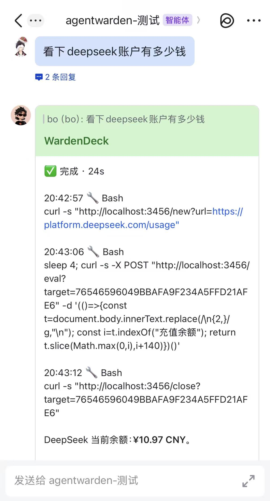

<div align="center">

#  WardenDeck

### Your computer, one chat message away.

WardenDeck is a **self-hosted control plane** that puts the coding agents on your machine behind Feishu/Lark. Send a task from your phone, watch it run live, approve risky tool calls, and keep a tamper-evident record — with no inbound port and no data leaving your machine.

[](https://nodejs.org)
[](LICENSE)
[](#current-limitations)
[](#requirements)

[Quick start](#quick-start) · [Design doc](DESIGN.md) · [Security](#security-model) · [Issues](https://github.com/bocoboho/wardendeck/issues)

</div>

<p align="center">
  
</p>

---

## What you get

- **📱 Work from anywhere.** Your phone is the terminal — no SSH, remote desktop, or second app.
- **🛡️ Approve before it acts.** Each tool call can pause for your approval: once, 30 minutes, or deny. Only the person who started the task can approve it.
- **🧾 Prove what happened.** Messages, approvals, agent runs, and attachments go into an append-only log secured by a SHA-256 hash chain.
- **🔒 Keep the agent in a box.** On macOS, Claude Code and every tool it spawns run under `sandbox-exec`, enforced by the kernel.
- **🧠 Own the whole stack.** Per-bot memory (assistant / project / chat / user scopes), encrypted credentials, local SQLite, and a console that listens on `127.0.0.1` only.

---

## Quick start

### Requirements

- **Node.js >= 22.13** (uses built-in `node:sqlite`)
- **macOS or Linux** (kernel sandbox is macOS-only)
- **Claude Code installed and logged in** — `claude` on your `PATH`

### 1. Install

```bash
git clone https://github.com/bocoboho/wardendeck.git
cd wardendeck
npm install && npm run build
npm link
```

`npm link` puts `wardendeck` on your `PATH`. Without it, use `node dist/cli.js <command>` instead.

### 2. Initialize and create a project

```bash
wardendeck init --admin-email you@example.com
mkdir -p ~/code/demo
wardendeck project create --name demo --workdir ~/code/demo
```

`init` creates `~/.wardendeck` (`0700`), `master.key`, the database, and a one-time web console token. The local agent is detected automatically.

> [!IMPORTANT]
> Back up `~/.wardendeck/master.key` with the database. It is the only key that can decrypt saved credentials.

### 3. Connect Feishu / Lark

```bash
wardendeck feishu setup --project demo
```

Open the printed link on your phone and approve. WardenDeck creates the app, stores the credential (`feishu_demo`), and **binds your private chat automatically**.

> [!NOTE]
> In the Feishu console, enable **Event subscription → long connection** and subscribe to `im.message.receive_v1`. For approval buttons, add the `card.action.trigger` callback; without it, reply `1 / 2 / 3` to approve.

<details>
<summary>Use an existing Feishu app instead</summary>

1. Create a **custom app** in the [Feishu Open Platform](https://open.feishu.cn/app) (use `open.larksuite.com` for Lark).
2. Enable **Bot**, request `im:message`, `im:message:send_as_bot`, and `im:chat:readonly`.
3. Enable the long-connection event subscription described above, then publish a version.
4. Save the credential and bind a chat:

```bash
wardendeck secret set feishu_demo --value "cli_xxx
app_secret_xxx"

wardendeck platform bind --project demo --platform feishu \
  --credential feishu_demo --channel oc_xxx
```

The first line is the App ID and the second is the App Secret; add a third line `lark` for the international version. Without `--allowed-users`, only the app owner is allowed.

</details>

<details>
<summary>Bind a group chat (optional)</summary>

Add the bot to the group, list its chats, then bind the group's `oc_...` ID:

```bash
wardendeck feishu chats --credential feishu_demo
wardendeck platform bind --project demo --platform feishu \
  --credential feishu_demo --channel oc_xxx --allowed-users ou_aaa,ou_bbb
```

In groups the bot only responds when **this bot** is @-mentioned.

</details>

### 4. Start and send a message

```bash
wardendeck serve
```

Message the bot in Feishu:

> 你好，看一下这个目录里有什么

An execution card appears under your message, updates in place with tool progress, pauses for approval, and turns green when done:

<p align="center">
  
</p>

- Reply `1` allow once · `2` allow 30 minutes · `3` deny
- Send `/stop` to cancel the current task
- The web console is at <http://127.0.0.1:8787> (sign in with the token from `init`). Disable it with `wardendeck serve --no-web`.

> [!NOTE]
> A sleeping laptop is offline. Keep it awake with `caffeinate -is wardendeck serve`, or run WardenDeck on an always-on host.

---

## How it works

1. Feishu delivers `im.message.receive_v1` over a long connection.
2. WardenDeck matches the chat against a binding, checks `allowed_users` and the @-mention rule, and records `message.inbound`.
3. The message is queued per chat and written to a persistent Claude Code process in the project's `workdir`.
4. Tool permission requests become approval cards; the idle timer pauses while a human decides.
5. Progress patches the same card; the final answer completes it and records `message.outbound`.
6. The native session ID is saved per chat and reused with `--resume`.

---

## Security model

| Layer | What it does |
|---|---|
| **Allowlist** | Bindings require `allowed_users`; unknown chats get no response. Omitting it defaults to the app owner. |
| **Mentions** | Group chats respond only when this specific bot is @-mentioned. |
| **Approvals** | Tool calls follow the project's permission mode; only the task starter can approve. |
| **Sandbox** | macOS `sandbox-exec` denies access to the data directory and `WARDENDECK_DENY_PATHS`. |
| **Secrets** | Credentials encrypted with AES-256-GCM using `master.key`. |
| **Audit** | Append-only SHA-256 hash chain; `wardendeck audit verify` checks integrity. |
| **Network** | Listens on `127.0.0.1` by default; no inbound public port. |
| **Files** | Data directory `0700`; database and master key `0600`. |

WardenDeck is a prototype. The database is not encrypted; do not expose port `8787` to the internet.

---

## Chat commands

| Command | Effect |
|---|---|
| `1` / `允许` | Allow this tool call |
| `2` / `允许30分钟` | Allow tool calls for 30 minutes |
| `3` / `拒绝` | Deny this tool call |
| `/stop` | Stop the current task and cancel pending approvals |
| `/remember <text>` | Save a memory (private chat → user scope, group → chat scope) |
| `/memory` | List visible long-term memories |
| `/forget <id>` | Delete a memory in the current scope |
| `AW_ATTACH: /path/image.png` | In a final answer, send a local image |

Per-message limits: 10 minutes without output, 30 minutes wall clock, 100 tool calls.

---

## CLI reference

<details>
<summary>Show all commands</summary>

```bash
wardendeck init [--dir DIR] [--admin-email EMAIL] [--bind HOST:PORT] [--force]
wardendeck serve [--dir DIR] [--no-web]
wardendeck doctor
wardendeck status
wardendeck agents

wardendeck token reset [--set TOKEN]

wardendeck project create --name NAME --workdir PATH [--agent claudecode] [--permission-mode MODE]
wardendeck project list
wardendeck project permission --name NAME --mode MODE

wardendeck assistant add --name NAME [--agent claudecode]
wardendeck assistant list

wardendeck memory add --assistant NAME --scope assistant|project|chat|user \
  [--scope-id ID] [--text TEXT]
wardendeck memory list --assistant NAME
wardendeck memory forget --assistant NAME --id N

wardendeck secret set REF [--value VALUE]
wardendeck secret list

wardendeck platform test --platform feishu --credential REF [--send-to ID] [--text TEXT]
wardendeck platform bind --project NAME --platform feishu \
  --credential REF --channel ID [--allowed-users ID[,ID]]
wardendeck platform list
wardendeck platform unbind --id BINDING_ID

wardendeck feishu setup [--project NAME] [--credential REF]
wardendeck feishu chats [--credential REF]

wardendeck user add --email EMAIL [--role owner|admin|operator|viewer]
wardendeck user map --platform feishu --external-id OPEN_ID --email EMAIL
wardendeck user grant --project NAME --email EMAIL [--role operator]

wardendeck model add --id ID [--display-name NAME] [--provider PROVIDER]
wardendeck model set --project NAME --default ID
wardendeck model list

wardendeck audit list [--limit N]
wardendeck audit verify
```

All commands accept `--dir`, defaulting to `~/.wardendeck` or `$WARDENDECK_DIR`.

</details>

---

## Configuration

| Variable | Purpose |
|---|---|
| `WARDENDECK_DIR` | Data directory (default `~/.wardendeck`) |
| `WARDENDECK_DENY_PATHS` | Extra paths the agent may not read or execute, separated by the OS path delimiter |
| `WARDENDECK_SANDBOX=0` | Disable the macOS sandbox (not recommended) |
| `WARDENDECK_CLAUDE_AUTO_MEMORY=1` | Re-enable Claude Code's built-in auto memory (off by default to avoid leaking facts across bots) |

Permission modes: `default`, `acceptEdits`, `plan`, `dontAsk`, `auto`, `bypassPermissions` (dangerous).

---

## Troubleshooting

<details>
<summary>The bot does not reply</summary>

1. Is `wardendeck serve` running?
2. `wardendeck status` — is the binding there?
3. In the Feishu console: long connection enabled, `im.message.receive_v1` subscribed, app published.
4. `wardendeck audit list` — look for `message.inbound`:
   - absent → the event never arrived; check the event subscription;
   - present → check `allowed_users` against the sender's `open_id`.

</details>

<details>
<summary>It replies in private chat but not in a group</summary>

- The bot only answers when **this bot** is @-mentioned.
- Verify the group `chat_id` with `wardendeck feishu chats`.
- Use the `oc_...` group ID, not your personal `ou_...` ID.

</details>

<details>
<summary>No approval card appears</summary>

Add the `card.action.trigger` callback in the Feishu console. Until then, reply `1 / 2 / 3` to the approval prompt.

</details>

<details>
<summary>Doctor or secrets fail</summary>

```bash
wardendeck doctor
wardendeck audit verify
```

A `secrets` failure usually means the database and `master.key` do not belong together. Restore the matching key, or re-enter the credentials with `wardendeck secret set`.

</details>

---

## Current limitations

- **Claude Code is the only execution adapter.** Codex is detected but not wired up.
- **Slack and Telegram** support credential tests and bindings, but not message ingestion yet.
- **macOS-only kernel sandbox.** On Linux, run under a dedicated user or container.
- **Native sessions are not shared across agents**; only semantic memory is.
- **Models are optional.** Claude Code uses its own configured model by default.
- **Sleep means offline.** Use `caffeinate`, an always-on host, or a server.

---

## Development

```bash
npm run build     # TypeScript -> dist/
npm test          # build + node:test
npm run dev       # build and start the CLI
```

| Path | Contents |
|---|---|
| `src/cli.ts` | Command dispatch and onboarding |
| `src/feishu.ts` | Long connection, routing, cards, approvals |
| `src/claude.ts` | stream-json session, permissions, process limits |
| `src/store.ts` | SQLite schema, memory, audit chain, secret encryption |
| `src/server.ts` | HTTP API and web console |
| `web/index.html` | Single-file console |

---

## Contributing

Issues and pull requests are welcome. For larger changes, open an issue first. Keep the prototype honest: if a capability is partial, document it as partial.

---

## License

[MIT](LICENSE)
